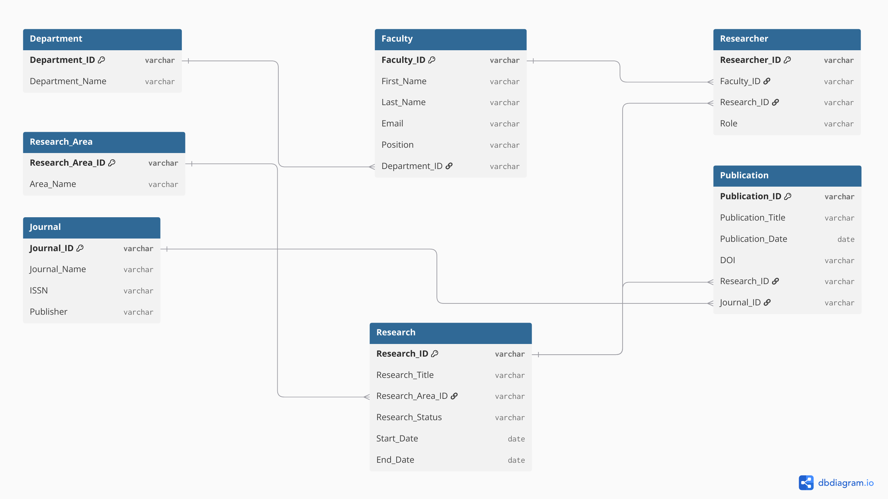

# Faculty Research & Publication Database

**Developer:** Raiza D. Namoco  
**Project Type:** Academic Research Database Management System

---

## 1. Project Description

The Faculty Research & Publication Database is a database management system that organizes faculty information, research projects, research areas, publications, journals, and researcher participation in an academic institution.

Google Sheets stores the data, AppSheet provides the application used to view, add, and update records, and GitHub documents the project.

The goal is to make faculty research information easier to access, maintain, and monitor.

---

## 2. Project Objectives

- Organize faculty and department information.
- Manage research projects and their research areas.
- Record academic publications and journal information.
- Track which faculty members participate in which research projects, and their roles.
- Maintain relationships between researchers, research projects, and publications.
- Reduce duplicate and inconsistent data through proper database design.
- Provide an accessible application for managing research records.
- Support the monitoring of faculty research and publication activities.

---

## 3. Main Features

- **Faculty Management** – Stores faculty names, email addresses, positions, and department assignments.
- **Department Management** – Organizes faculty members by department.
- **Research Management** – Records research titles, research areas, statuses, and start/end dates.
- **Research Area Management** – Classifies research projects by area of study.
- **Researcher Management** – Records faculty participation in research projects and their roles.
- **Publication Management** – Stores publication titles, publication dates, DOIs, and the related research and journal.
- **Journal Management** – Maintains journal names, ISSNs, and publishers.
- **Data Relationships** – Connects related records through primary keys, foreign keys, and AppSheet references (Ref columns).
- **Record Management** – AppSheet forms and views are used to add, display, and update records.

---

## 4. Technologies Used

| Technology | Purpose |
|---|---|
| **AppSheet** | Builds the application interface: forms, table views, detail views, and other views. |
| **Google Sheets** | Data source that stores the seven tables, one per sheet tab. |
| **GitHub** | Stores this README and other project files for documentation and sharing. |

---

## 5. Database Structure

The database has **seven tables**.

| Table | Description |
|---|---|
| Department | Stores department IDs and department names. |
| Faculty | Stores faculty information and each faculty member's department. |
| Research_Area | Stores research area IDs and area names. |
| Research | Stores research titles, research areas, statuses, and dates. |
| Researcher | Links faculty members to research projects and records their roles (junction table). |
| Publication | Stores publication titles, dates, DOIs, and the related research and journal. |
| Journal | Stores journal names, ISSNs, and publishers. |

### Entity-Relationship Diagram (ERD)

### Relationships

| Relationship | Type | Implemented by |
|---|---|---|
| Department → Faculty | One-to-many | `Faculty.Department_ID` |
| Research_Area → Research | One-to-many | `Research.Research_Area_ID` |
| Faculty → Researcher | One-to-many | `Researcher.Faculty_ID` |
| Research → Researcher | One-to-many | `Researcher.Research_ID` |
| Faculty ↔ Research | Many-to-many | Through the **Researcher** table |
| Research → Publication | One-to-many | `Publication.Research_ID` |
| Journal → Publication | One-to-many | `Publication.Journal_ID` |

The **Researcher** table is the linking (junction) table between Faculty and Research. It lets one faculty member join many projects and one project include many faculty members, and it stores each person's **Role** on that project.

---

## 6. Keys and Data Integrity

- **Primary Key (PK):** uniquely identifies each record in a table.
- **Foreign Key (FK):** a field that refers to a record in another table.
- **Reference (Ref):** the AppSheet column type that connects a column to a record in another table.
- **Data validation:** rules that help ensure users enter appropriate values.

| Table | Primary Key | Foreign Key(s) |
|---|---|---|
| Department | Department_ID | – |
| Faculty | Faculty_ID | Department_ID |
| Research_Area | Research_Area_ID | – |
| Research | Research_ID | Research_Area_ID |
| Researcher | Researcher_ID | Faculty_ID, Research_ID |
| Publication | Publication_ID | Research_ID, Journal_ID |
| Journal | Journal_ID | – |

---

## 7. Data Dictionary

Data types are as shown in the ERD (`varchar` = text, `date` = calendar date).

### Department
| Field | Type | Description |
|---|---|---|
| Department_ID | varchar | Unique identifier of the department. |
| Department_Name | varchar | Name of the department. |

### Faculty
| Field | Type | Description |
|---|---|---|
| Faculty_ID | varchar | Unique identifier of the faculty member. |
| First_Name | varchar | Faculty member's first name. |
| Last_Name | varchar | Faculty member's last name. |
| Email | varchar | Faculty member's email address. |
| Position | varchar | Faculty member's position or job title. |
| Department_ID | varchar | Department the faculty member belongs to (FK). |

### Research_Area
| Field | Type | Description |
|---|---|---|
| Research_Area_ID | varchar | Unique identifier of the research area. |
| Area_Name | varchar | Name of the research area. |

### Research
| Field | Type | Description |
|---|---|---|
| Research_ID | varchar | Unique identifier of the research project. |
| Research_Title | varchar | Title of the research project. |
| Research_Area_ID | varchar | Research area of the project (FK). |
| Research_Status | varchar | Current status of the project. |
| Start_Date | date | Date the project started. |
| End_Date | date | Date the project ended or is expected to end. |

### Researcher
| Field | Type | Description |
|---|---|---|
| Researcher_ID | varchar | Unique identifier of the participation record. |
| Faculty_ID | varchar | Faculty member who participates (FK). |
| Research_ID | varchar | Research project participated in (FK). |
| Role | varchar | Role of the faculty member in the project. |

### Publication
| Field | Type | Description |
|---|---|---|
| Publication_ID | varchar | Unique identifier of the publication. |
| Publication_Title | varchar | Title of the published work. |
| Publication_Date | date | Date the work was published. |
| DOI | varchar | Digital Object Identifier of the work. |
| Research_ID | varchar | Research project the publication is related to (FK). |
| Journal_ID | varchar | Journal where the work was published (FK). |

### Journal
| Field | Type | Description |
|---|---|---|
| Journal_ID | varchar | Unique identifier of the journal. |
| Journal_Name | varchar | Name of the journal. |
| ISSN | varchar | International Standard Serial Number of the journal. |
| Publisher | varchar | Organization that publishes the journal. |

---

## 8. Database Design and Normalization

The database splits information into related tables instead of storing everything in one large table.

**First Normal Form (1NF):** Each field holds a single value and each record is uniquely identifiable. For example, a faculty member's several projects are stored as separate rows in `Researcher`, not as a list in one cell.

**Second Normal Form (2NF):** The tables satisfy 1NF, and every non-key attribute depends on the whole primary key. `Researcher` uses a single-column key (`Researcher_ID`), so no partial dependency can occur, and `Role` describes the whole participation record.

**Third Normal Form (3NF):** No non-key attribute depends on another non-key attribute. For example, `Faculty` stores `Department_ID` rather than `Department_Name`, and `Publication` stores `Journal_ID` rather than the journal's ISSN or publisher. Those details are stored once in `Department` and `Journal`.

Normalization reduces duplication and improves data consistency.

---

## 9. How to Use the Application

1. **Open the application** using the AppSheet link in Section 12.
2. **Browse the views** to reach faculty, departments, research areas, research projects, researchers, publications, and journals.
3. **Add a record:** open the section, select the add (+) option, fill in the required fields, and save.
4. **Update a record:** open the record, select edit, change the information, and save.
5. **Review related information:** open a record and use its related records (for example, a department's faculty or a research project's researchers).
6. **Check the data:** make sure IDs are correct and that referenced records exist before saving.

> Menu names and available actions depend on the AppSheet configuration and the user's permissions.

---

## 10. Project Benefits

- Provides one organized place for faculty research information.
- Makes research and publication records easier to manage.
- Shows which faculty members take part in which research projects.
- Improves consistency through related tables.
- Provides a foundation for reviewing research and publication activity.

---

## 11. Limitations and Future Improvements

### Current limitations
- Each publication is linked to only **one** research project (`Publication.Research_ID`). A publication that comes from several projects would need an additional linking table.
- There is no direct Publication–Faculty (author) table, so co-authorship is represented indirectly through researchers on the same project.
- `Research_Status` is a text field in the ERD. Using a fixed list of values (an Enum) would keep statuses consistent.
- Google Sheets does not enforce keys or references by itself, so data accuracy depends on AppSheet settings and the people entering data.
- The `Researcher` table could be named more clearly (for example, `Research_Participation`) because it stores participation records, not researcher profiles.

### Possible future improvements
- Add a `Publication_Author` table to record authors of each publication directly.
- Add a research and publication dashboard with status and count summaries.
- Add search and filter tools.
- Improve input validation and duplicate prevention (for example, End_Date not earlier than Start_Date, and no duplicate faculty–research pairs).
- Improve user access controls and data security.
- Provide exportable reports for academic monitoring.

These are suggestions and are not part of the current application unless stated in Section 3.

---

## 12. Project Links

- **AppSheet Application:** [Open the Faculty Research & Publication Database](https://www.appsheet.com/Template/AppDef?appName=FacultyandPublication-756053880&utm_source=share_app_link)

---

## 13. Conclusion

The Faculty Research & Publication Database provides a structured way to manage faculty information, research projects, researcher participation, academic publications, and journal records. By combining AppSheet, Google Sheets, and GitHub, the project shows how a relational database design can support the organization and management of academic research information.

The project applies fundamental database concepts, including primary keys, foreign keys, relationships, and normalization, to keep records consistent and organized.
